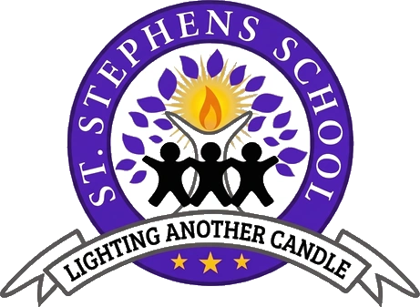

<div align="center">

  

  # 🎓 St. Stephen's School — Official Web Platform
  ### *Shaping Tomorrow's Leaders Since 2001*

  <p align="center">
    A state-of-the-art, high-performance web portal built for <strong>St. Stephen's School (Bowbazar, Kolkata)</strong> — an NGO-driven educational institution empowering 500+ underprivileged students through academic excellence, holistic development, and digital innovation.
  </p>

  <p align="center">
    <a href="https://github.com/yash12345-ctrl/Stephen--School_website/blob/main/LICENSE">
      
    </a>
    <a href="https://react.dev/">
      
    </a>
    <a href="https://www.typescriptlang.org/">
      
    </a>
    <a href="https://vitejs.dev/">
      
    </a>
    <a href="https://vercel.com/">
      
    </a>
    <a href="#-security--obfuscation">
      
    </a>
  </p>

  <p align="center">
    <a href="#-key-features">Key Features</a> •
    <a href="#-live-pages--routing">Pages & Routes</a> •
    <a href="#-tech-stack">Tech Stack</a> •
    <a href="#-getting-started">Getting Started</a> •
    <a href="#-image-optimization-engine">Asset Pipeline</a> •
    <a href="#-security--production-hardening">Security</a> •
    <a href="#-project-structure">Project Structure</a>
  </p>

</div>

---

## 📖 Institutional Background

Established in **2001** in the heart of **Bowbazar, Kolkata**, **St. Stephen's School** is dedicated to the social and educational empowerment of first-generation learners and underprivileged children. Operating under an NGO framework, the school provides tuition from **Lower Nursery through Class X** following the **West Bengal Board of Secondary Education (WBBSE / Madhyamik)** syllabus. 

With over two decades of selfless service, the institution has welcomed esteemed dignitaries—including the **Governor of West Bengal (Shri Keshari Nath Tripathi)**, foreign diplomats (**Deputy Consul General of Germany**), and prominent cultural icons—creating a legacy where academic rigor meets humanitarian values.

---

## ✨ Key Features & UX Highlights

### 🌟 Immersive Interactive Experiences
- **3D Digital FlipBook Chronicle (`react-pageflip`)**: An interactive, skeuomorphic flipbook inside the News portal that simulates turning real magazine and newspaper pages to browse historical visits, press coverage, and VIP delegations.
- **Dynamic Mouse-Tracking Parallax Hero**: Smooth mathematical mouse-position mapping (`--mouse-x`, `--mouse-y`) in the Hero section delivering subtle depth and responsive ambient glow effects.
- **Interactive Multi-Level Organization Chart**: Dynamic tree hierarchy viewer in the Gallery illustrating the school's leadership: Hony. Secretary, Head-Mistress, Administrators, and the Advisory Board.
- **Intelligent Program Mega Menu**: Desktop dropdown menu with smooth delayed close timers (`ProgramMegaMenu`) and quick visual shortcuts to all co-curricular programs.
- **Interactive Giving & Donation Portal**: Impact calculator mapping contribution tiers (e.g., ₹1,000 for study supplies up to ₹50,000 for digital classrooms) alongside one-click clipboard copying for banking credentials.

### ⚡ Performance & Asset Engineering
- **Automated WebP Conversion Engine (`optimize.mjs`)**: Dedicated Node.js pipeline using `sharp` to automatically transcode PNG/JPEG media to high-fidelity WebP (quality: 80, effort: 4) and auto-inject `loading="lazy"` tags across all JSX/TSX components.
- **Vercel Speed Insights Integration**: Real-time Core Web Vitals telemetry (`@vercel/speed-insights`) capturing LCP, FID, and CLS across real user journeys.
- **Fine-Grained Vendor Chunking**: Custom Rollup output configuration separating core frameworks (`react`, `react-dom`, `react-router-dom`) into dedicated cached vendor bundles.

### 🛡️ Enterprise-Grade Security
- **Production AST Code Obfuscation**: Powered by `vite-plugin-javascript-obfuscator`, builds enforce control flow flattening, dead code injection, debug protection loops, string array shuffling/encoding, and self-defending runtimes.
- **Strict HTTP Security Headers**: Configured via `vercel.json` with HSTS preloading (`max-age=31536000`), `X-Frame-Options: DENY`, `X-Content-Type-Options: nosniff`, Referrer-Policy, and strict `Permissions-Policy`.

---

## 🗺️ Live Pages & Routing Architecture

| Route | Component | Description |
| :--- | :--- | :--- |
| `/` | [`App.tsx`](src/App.tsx) | Main landing page featuring the hero parallax, admissions snapshot, core pillars, and campus stats. |
| `/about` | [`about.tsx`](src/about.tsx) | Institutional history, vision & mission typewriter carousel, core values, and governance. |
| `/the-school` | [`school.tsx`](src/school.tsx) | Virtual campus tour covering Assembly Hall, Smart Classrooms, Computer Labs, and Playrooms. |
| `/news` | [`news.tsx`](src/news.tsx) | Archival interactive 3D FlipBook covering VIP dignitary visits, governor honors, and media press. |
| `/gallery` | [`gallery.tsx`](src/gallery.tsx) | Photo showcases, event albums, and the interactive Governing Body organizational structure. |
| `/donate` | [`donate.tsx`](src/donate.tsx) | NGO sponsorship portal with tiered student impact cards and bank transfer details. |
| `/annual-concert` | [`annual_concert.tsx`](src/annual_concert.tsx) | Retrospective on the school's flagship annual cultural concert and student performances. |
| `/annual-picnic` | [`annual_picnic.tsx`](src/annual_picnic.tsx) | Highlights from annual student excursions and nature excursions. |
| `/christmas` | [`christmas.tsx`](src/christmas.tsx) | Winter celebration gallery, student nativity showcases, and community festivities. |
| `/eid` | [`eid.tsx`](src/eid.tsx) | Inter-faith harmony celebration albums and festive gatherings. |
| `/rabindrajayanti` | [`rabindrajayanti.tsx`](src/rabindrajayanti.tsx) | Cultural tribute to Rabindranath Tagore featuring poetry, song, and traditional dance. |
| `/indep` | [`indep.tsx`](src/indep.tsx) | Independence Day flag hoisting, parades, and patriotic programs. |
| `/art-and-craft-exhibition` | [`art_craft.tsx`](src/art_craft.tsx) | Creative exhibitions of recycled handicrafts, paintings, and student sculptures. |
| `/educational-day-out` | [`educational_day_out.tsx`](src/educational_day_out.tsx) | Field trips to the Science City, Birla Planetarium, and Indian Museum. |

---

## 💻 Tech Stack

### Core Technologies
- **UI Library**: [React 19](https://react.dev/) (`^19.2.6`)
- **Type Safety**: [TypeScript](https://www.typescriptlang.org/) (`~6.0.2`)
- **Build Tool & Bundler**: [Vite](https://vitejs.dev/) (`^4.5.14`)
- **Routing**: [React Router](https://reactrouter.com/) (`^7.15.1`)
- **Motion & Animations**: [Framer Motion](https://www.framer.com/motion/) (`^12.40.0`)
- **Icons**: [Lucide React](https://lucide.dev/) (`^1.17.0`)
- **3D FlipBook Reader**: [React PageFlip](https://github.com/nodlik/react-pageflip) (`^2.0.3`)
- **Performance Telemetry**: [@vercel/speed-insights](https://vercel.com/docs/speed-insights) (`^2.0.0`)

### Styling & Design System
- **Pure Vanilla CSS**: Bespoke, scoped styles across 20+ dedicated style sheets (`App.css`, `school.css`, `donate.css`, `fonts.css`, etc.)
- **Color Palette**: Sophisticated Deep Royal Navy (`#060d1d`), Regal Gold (`#c5a059`), Emerald Accents, and Dark Glassmorphism.
- **Custom Typography**: Tailored font loading and fluid font scale.

### Tooling & Build Pipeline
- **Image Transcoding**: [Sharp](https://sharp.pixelplumbing.com/) (`^0.35.1`)
- **Code Obfuscation**: [vite-plugin-javascript-obfuscator](https://github.com/mubaidr/vite-plugin-javascript-obfuscator) (`^3.1.0`)
- **Linting & Code Quality**: [ESLint](https://eslint.org/) (`^10.3.0`) + [typescript-eslint](https://typescript-eslint.io/) (`^8.59.2`)

---

## 🚀 Getting Started

### Prerequisites
- **Node.js**: `v18.x` or higher (LTS recommended)
- **npm**: `v9.x` or higher

### 1. Clone the Repository
```bash
git clone https://github.com/yash12345-ctrl/Stephen--School_website.git
cd Stephen--School_website
```

### 2. Install Dependencies
```bash
npm install
```

### 3. Launch Development Server
```bash
npm run dev
```
Open [http://localhost:5173](http://localhost:5173) in your browser to view the application with Hot Module Replacement (HMR).

### 4. Create Production Build
```bash
npm run build
```
This runs the TypeScript compiler (`tsc -b`), executes Rollup bundling, generates vendor chunks, and applies JavaScript code obfuscation into the `dist/` directory.

### 5. Preview Production Bundle Locally
```bash
npm run preview
```

---

## 🖼️ Image Optimization Engine

The repository includes a dedicated asset optimization script (`optimize.mjs`) to maintain lightning-fast page speeds for the high-resolution photo gallery.

Run the pipeline:
```bash
node optimize.mjs
```

**What it does:**
1. Traverses `./public` recursively for `.png`, `.jpg`, and `.jpeg` files.
2. Converts them to `.webp` format at **80% quality** with high-effort compression via `sharp`.
3. Safely removes the original bulky assets.
4. Updates all source code references (`.tsx`, `.ts`, `.css`) in `./src` to point to the new `.webp` paths.
5. Injects native `loading="lazy"` attributes into all `` elements.

---

## 🔒 Security & Production Hardening

### 1. Reverse-Engineering Protection
During `npm run build`, the application utilizes AST-level JavaScript obfuscation configured in [`vite.config.ts`](vite.config.ts):
- **Dead Code Injection**: Injects dummy instruction blocks to defeat automated static analyzers.
- **Control Flow Flattening**: Transforms straightforward conditional logic into complex switch-case state machines.
- **String Encryption**: Encodes sensitive strings in Base64 arrays with random runtime index shifting and rotation.
- **Debugger Protection**: Thwarts unauthorized devtool inspections via automated anti-debugging triggers.

### 2. HTTP Security Configuration
Deployed on Vercel with defensive headers configured in [`vercel.json`](vercel.json):
```json
{
  "headers": [
    {
      "source": "/(.*)",
      "headers": [
        { "key": "X-Content-Type-Options", "value": "nosniff" },
        { "key": "X-Frame-Options", "value": "DENY" },
        { "key": "Strict-Transport-Security", "value": "max-age=31536000; includeSubDomains; preload" },
        { "key": "Referrer-Policy", "value": "strict-origin-when-cross-origin" },
        { "key": "Permissions-Policy", "value": "camera=(), microphone=(), geolocation=(), browsing-topics=()" }
      ]
    }
  ]
}
```

---

## 📂 Project Structure

```text
Stephen--School_website/
├── public/                       # Static assets, WebP images, logos, icons, robots.txt
│   ├── favicon.svg               # Web crest favicon
│   ├── v2.webp                   # St. Stephen's School official crest
│   └── ...                       # Optimized event & gallery photographs
├── src/
│   ├── assets/                   # SVG icons and vector illustrations
│   ├── App.tsx                   # Homepage & Hero Section
│   ├── App.css                   # Homepage styles & keyframe animations
│   ├── Navbar.tsx                # Responsive navigation bar & mobile drawer
│   ├── program_top.tsx           # Programs mega menu component
│   ├── about.tsx & about.css     # About page & history timeline
│   ├── school.tsx & school.css   # Campus facilities & infrastructure
│   ├── news.tsx & news.css       # 3D FlipBook interactive reader
│   ├── gallery.tsx & gallery.css # Media gallery & governing body tree
│   ├── donate.tsx & donate.css   # Giving portal & impact metrics
│   ├── annual_concert.tsx        # Event: Annual Concert
│   ├── annual_picnic.tsx         # Event: Annual Excursion & Picnic
│   ├── christmas.tsx             # Event: Christmas Celebrations
│   ├── eid.tsx                   # Event: Eid Celebrations
│   ├── rabindrajayanti.tsx       # Event: Rabindra Jayanti Celebrations
│   ├── indep.tsx                 # Event: Independence Day
│   ├── art_craft.tsx             # Event: Art & Craft Exhibition
│   ├── educational_day_out.tsx   # Event: Educational Excursions
│   ├── fonts.css                 # Web font declarations
│   ├── index.css                 # Base resets & CSS variables
│   └── main.tsx                  # Application entry point & React Router DOM
├── optimize.mjs                  # Automated Sharp WebP image compression script
├── vercel.json                   # Vercel SPA rewrites & security HTTP headers
├── vite.config.ts                # Vite config, code obfuscator & chunk splitting
├── tsconfig.json                 # TypeScript project configuration
├── package.json                  # Dependencies, scripts & metadata
└── README.md                     # Project documentation
```

---

## 🤝 Contributing & Maintenance

1. **Create a Feature Branch**:
   ```bash
   git checkout -b feature/your-feature-name
   ```
2. **Commit Your Changes**:
   ```bash
   git commit -m "feat: Add new event gallery section"
   ```
3. **Push to the Branch**:
   ```bash
   git push origin feature/your-feature-name
   ```
4. **Open a Pull Request** on GitHub.

---

## 📜 License & Acknowledgments

- **License**: Distributed under the [MIT License](LICENSE).
- **Institution**: [St. Stephen's School](https://github.com/yash12345-ctrl/Stephen--School_website), Bowbazar, Kolkata.
- **Gratitude**: Special thanks to the faculty, governing board, and supporters of St. Stephen's School for their enduring commitment to educating underprivileged youth.

<div align="center">
  <sub>Built with ❤️ for St. Stephen's School, Bowbazar.</sub>
</div>
